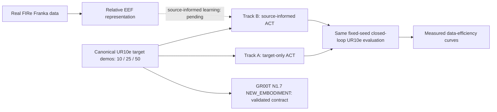
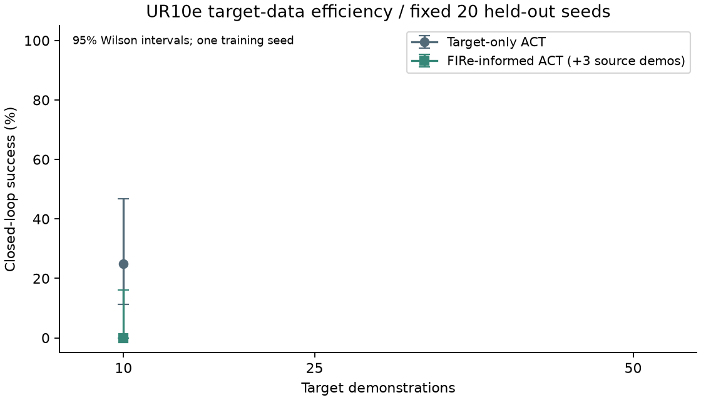
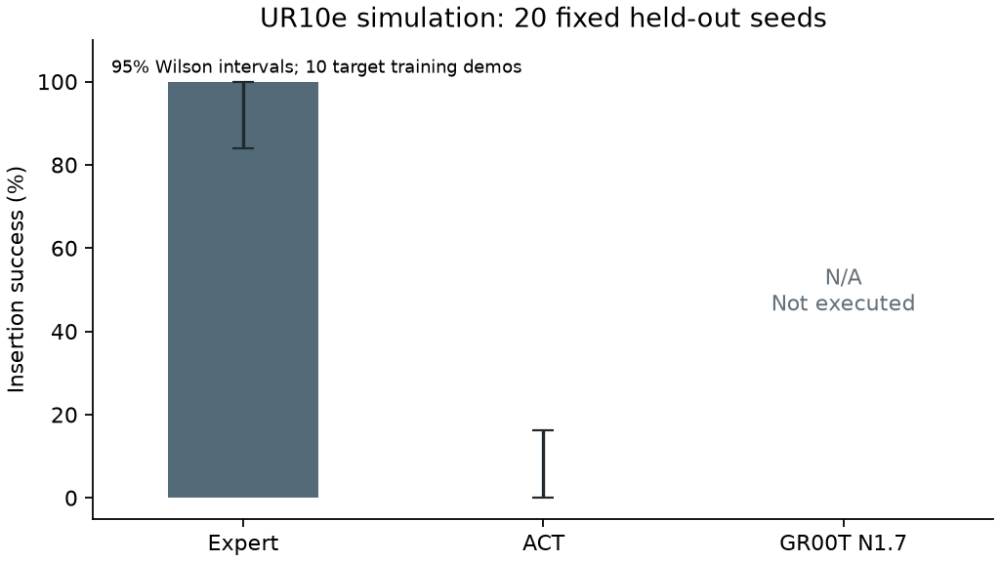

# GR00T N1.7 × UR10e

**Real-World Cross-Embodiment Robot Learning**

Real Franka demonstrations → Relative EEF representation → New UR10e embodiment →
Closed-loop data-efficiency evaluation.

Can real-world manipulation experience and an embodiment-independent action representation
reduce the target-robot data needed for precision insertion? This project tests target-only
versus source-informed ACT at **10, 25 and 50 target demonstrations**, with identical
closed-loop evaluation and a GR00T N1.7 NEW_EMBODIMENT integration path.

The canonical real source is [FIRe Franka peg insertion](https://huggingface.co/datasets/bhe1004/FIRe-VLA-GR00T-PegInsert-Real),
third-party public research data declaring Apache-2.0. [Actual source inspection](artifacts/datasets/fire_source.json) selected episode 29 wrist_view;
[the task audit](artifacts/datasets/fire_task_audit.json) currently classifies the tasks as
ANALOGOUS_TASK. Source-informed learning remains unexecuted; no data-efficiency result is claimed.


Real source: FIRe episode 29, wrist_view, frame 0. Third-party research data;
[attribution and modifications](references/FIRe-source-credit.md).



The current executable evidence includes recovered 10-demo target-only learned control
on the original fixed held-out protocol, with an independently repeated successful seed.
The paired 10/25/50 source-informed study remains in progress.

The official UR10e asset, deterministic reset, collision checks and actual front RGB
capture are verified in [simulator evidence](artifacts/simulation/g1_smoke.json).
Ten successful scripted demonstrations provide 487 synchronized frames in one
[validated canonical dataset](artifacts/datasets/validation.json). Actions are
six-dimensional hole-frame translation/rotation deltas, not source-robot joint angles.
The exact units and composition are in the [local action contract](scripts/local/README.md).

Maintained LeRobot ACT trained from scratch on the RTX 4070 Ti, produced a real
checkpoint and reproduced its output after strict reloading. The [training summary](artifacts/training/act-10-001/summary.json)
and [full loss history](artifacts/training/act-10-001/loss.csv) identify the dataset,
model, environment and source hashes. Training data consists solely of project-generated
UR10e simulation; FIRe and DROID were not training data for this checkpoint.

## Data-efficiency experiment

<!-- STUDY:START -->
| Target demos | Target-only ACT | FIRe-informed ACT |
|---|---|---|
| 10 | 5/20 (25%) | 0/20 (0%) |

Both tracks use 5000 target updates. FIRe-informed adds 3 real source episodes and 1000 source updates.
Remaining target-data sizes: 25, 50.

[Structured evidence](artifacts/eval/data_efficiency.json) · [Measured CSV](artifacts/eval/data_efficiency.csv)


<!-- STUDY:END -->

## Closed-loop recovery

The original zero-success ACT checkpoint is retained as debugging evidence. A controlled
sequence restored ImageNet initialization, reduced backbone learning rate, used one-step
replanning and balanced rare orientation and precision-correction samples. No target data,
evaluation seed, task geometry, controller or success threshold changed.

The table is generated from all fixed held-out episodes and verified raw traces. The
[reproduction receipt](artifacts/diagnostics/heldout_recovery.json) links the first successful
held-out seed and its independent repeat. Remaining collisions are retained in the denominator.
These are target-only P0 smoke results; they do not yet measure cross-embodiment data efficiency.

<!-- RESULTS:START -->
| Policy | Training data | Actual training | Closed-loop evaluated | Success |
|---|---|---|---|---|
| Expert | scripted | N/A | yes | 20/20 (100%) |
| ACT baseline | 10 target demos | yes | yes | 0/20 (0%) |
| ACT recovered | 10 target demos | yes | yes | 5/20 (25%) |
| GR00T N1.7 | target-compatible | no | no | N/A |

[Expert episodes](artifacts/eval/expert-002/episodes.jsonl) · [ACT baseline episodes](artifacts/eval/act-10-002/episodes.jsonl) · [ACT recovered episodes](artifacts/eval/act-10-precision-heldout-001/episodes.jsonl)
<!-- RESULTS:END -->

[Generated comparison CSV](artifacts/eval/comparison.csv)



The first long evaluation stalled during the seventeenth scene reset. Its partial
results remain in [the failed-run record](artifacts/eval/act-10-001/summary.json).
The completed protocol isolates blocks of ten episodes in fresh simulator processes
for both policies. No checkpoint parameters or evaluation seeds changed during this
infrastructure recovery. The [first ACT failure image](artifacts/figures/act_first_failure.png)
and [raw video manifest](artifacts/video_manifest.json) preserve actual simulation evidence.

## Recovery checkpoint

A controlled one-episode test changed only the ResNet18 initialization to official
ImageNet weights and achieved learned insertion on training seed 10. The
[recovery receipt](artifacts/diagnostics/recovery.json) records identical data, optimizer,
steps, task, controller and detector. This demonstrates pipeline sanity, not generalization.
The recovered ten-demo checkpoint uses official LeRobot ACT, ImageNet ResNet18, H=1/K=1
at15Hz,5000 target steps and a four-regime sampler. Its [training evidence](artifacts/training/act-10-precision-001/summary.json)
and [fixed held-out evaluation](artifacts/eval/act-10-precision-heldout-001/summary.json)
identify every version, action contract and checkpoint hash. Diagnostic failures remain
versioned; the held-out checkpoint is frozen before the source-informed comparison.

The source/target audit is ANALOGOUS_TASK because source geometry and calibration remain
unverified. Final media still requires the paired data-efficiency study and native inspection.

## GR00T integration status

The real `GR00TPolicy` path uses the pinned official N1.7 policy, NEW_EMBODIMENT,
checkpoint modalities/statistics and physical action decoding. Official observation
batching and action round-trip tests pass in the [local contract report](artifacts/environment/gr00t_local_contract.json).
Model execution is `NOT_RUN` / `MODEL_COMPUTE_NOT_AVAILABLE` on Windows with 12 GB VRAM;
UR10e target-checkpoint validation is separately `NOT_RUN` because no adapted GR00T
checkpoint exists. The adapter rejects an incompatible base/DROID checkpoint.

The pinned [E0 cloud workflow](scripts/colab/README.md) is preserved. Its last recorded
inference failed, and no E0 PASS artifact is committed. E0 gates GR00T runtime claims,
not local ACT work. GR00T fine-tuning and real UR10e deployment are unexecuted.

## Reproduce

Follow [local setup, data generation, training and evaluation](scripts/local/README.md).
The Windows ML environment is isolated from Isaac Sim; dependency versions and
[upstream references](references/source_manifest.json) are pinned. Weights, raw data,
videos and caches are ignored by Git. The 20 held-out seeds were committed before
training. Rebuilding data produces a newly measured dataset hash; retain each run's
own provenance rather than assigning a previous hash.

```powershell
./scripts/local/setup.ps1
.venv/Scripts/python.exe -m unittest discover -s tests -v
python scripts/local/compare.py
```

Generate the real dataset and checkpoint first for artifact-dependent tests; absent
artifacts cause explicit skips. Plotting uses Matplotlib 3.11.1 in the `python`
environment. Clean ML-environment setup, CUDA training and actual simulation were
executed on this workstation; a fresh physical machine has not been tested.

[AGENTS.md](AGENTS.md) is the canonical plan; [HANDOFF.md](HANDOFF.md) records the
execution checkpoint. Public push, tagging and release remain separate gates.
