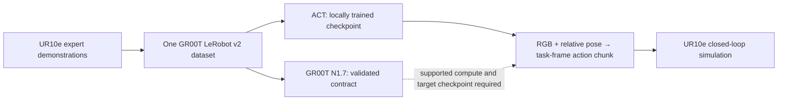

# GR00T N1.7 × UR10e Cross-Embodiment Robot Learning

A GR00T N1.7-compatible task-space dataset and policy interface, with real local ACT
training and checkpoint-controlled UR10e insertion in NVIDIA Isaac Sim. The research
question is whether cross-embodiment pretraining can reduce target demonstration needs.
The current experiment establishes the target learning/evaluation pipeline; transfer
from real Franka data and GR00T adaptation remain unexecuted.



The official UR10e asset, deterministic reset, collision checks and actual front RGB
capture are verified in [simulator evidence](artifacts/simulation/g1_smoke.json).
Ten successful scripted demonstrations provide 487 synchronized frames in one
[validated canonical dataset](artifacts/datasets/validation.json). Actions are
six-dimensional hole-frame translation/rotation deltas, not source-robot joint angles.
The exact units and composition are in the [local action contract](scripts/local/README.md).

Maintained LeRobot ACT trained from scratch on the RTX 4070 Ti, produced a real
checkpoint and reproduced its output after strict reloading. The [training summary](artifacts/training/act-10-001/summary.json)
and [full loss history](artifacts/training/act-10-001/loss.csv) identify the dataset,
model, environment and source hashes. Training data consists solely of project-generated
UR10e simulation; FIRe and DROID are references, not training data for this checkpoint.

## Closed-loop debugging baseline

The owner has prioritized recovery of reproducible learned-policy success. The
0/20 checkpoint is preserved as a baseline; final media assembly is gated on a
real learned held-out success. [Diagnostic evidence](artifacts/diagnostics/act-baseline-001/classification.json)
records the active investigation.

The table is generated from all fixed held-out episodes. Evaluation uses identical
seeds, initial states, task tolerances and action bounds for both executed policies.
ACT failed by collision throughout the completed evaluation. Lower training loss did
not translate into successful insertion; these results do not establish transfer or
successful learned control. Twenty episodes are a smoke evaluation, not a broad
performance study.

<!-- RESULTS:START -->
| Policy | Training data | Actual training | Closed-loop evaluated | Success |
|---|---|---|---|---|
| Expert | scripted | N/A | yes | 20/20 (100%) |
| ACT | 10 target demos | yes | yes | 0/20 (0%) |
| GR00T N1.7 | target-compatible | no | no | N/A |

[Expert episodes](artifacts/eval/expert-002/episodes.jsonl) · [ACT episodes](artifacts/eval/act-10-002/episodes.jsonl) · [ACT checkpoint evidence](artifacts/training/act-10-001/summary.json)
<!-- RESULTS:END -->

[Generated comparison CSV](artifacts/eval/comparison.csv)


The first long evaluation stalled during the seventeenth scene reset. Its partial
results remain in [the failed-run record](artifacts/eval/act-10-001/summary.json).
The completed protocol isolates blocks of ten episodes in fresh simulator processes
for both policies. No checkpoint parameters or evaluation seeds changed during this
infrastructure recovery. The [first ACT failure image](artifacts/figures/act_first_failure.png)
and [raw video manifest](artifacts/video_manifest.json) preserve actual simulation evidence.

## GR00T integration status

The real `GR00TPolicy` path uses the pinned official N1.7 policy, NEW_EMBODIMENT,
checkpoint modalities/statistics and physical action decoding. Official observation
batching and action round-trip tests pass in the [local contract report](artifacts/environment/gr00t_local_contract.json).
Model execution is `NOT_RUN` / `MODEL_COMPUTE_NOT_AVAILABLE` on Windows with 12 GB VRAM;
UR10e target-checkpoint validation is separately `NOT_RUN` because no adapted GR00T
checkpoint exists. The adapter rejects an incompatible base/DROID checkpoint.

The pinned [E0 cloud workflow](scripts/colab/README.md) is preserved. Its last recorded
inference failed, and no E0 PASS artifact is committed. E0 gates GR00T runtime claims,
not local ACT work. GR00T fine-tuning and real UR10e deployment are unexecuted.

## Reproduce

Follow [local setup, data generation, training and evaluation](scripts/local/README.md).
The Windows ML environment is isolated from Isaac Sim; dependency versions and
[upstream references](references/source_manifest.json) are pinned. Weights, raw data,
videos and caches are ignored by Git. The 20 held-out seeds were committed before
training. Rebuilding data produces a newly measured dataset hash; retain each run's
own provenance rather than assigning a previous hash.

```powershell
./scripts/local/setup.ps1
.venv/Scripts/python.exe -m unittest discover -s tests -v
python scripts/local/compare.py
```

Generate the real dataset and checkpoint first for artifact-dependent tests; absent
artifacts cause explicit skips. Plotting uses Matplotlib 3.11.1 in the `python`
environment. Clean ML-environment setup, CUDA training and actual simulation were
executed on this workstation; a fresh physical machine has not been tested.

[AGENTS.md](AGENTS.md) is the canonical plan; [HANDOFF.md](HANDOFF.md) records the
execution checkpoint. Public push, tagging and release remain separate gates.
